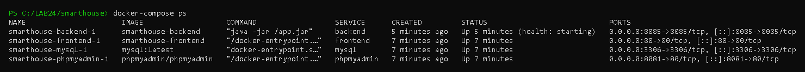
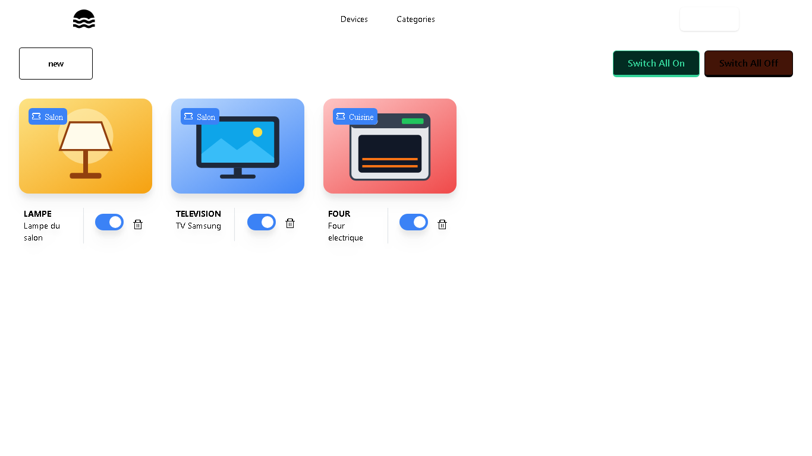
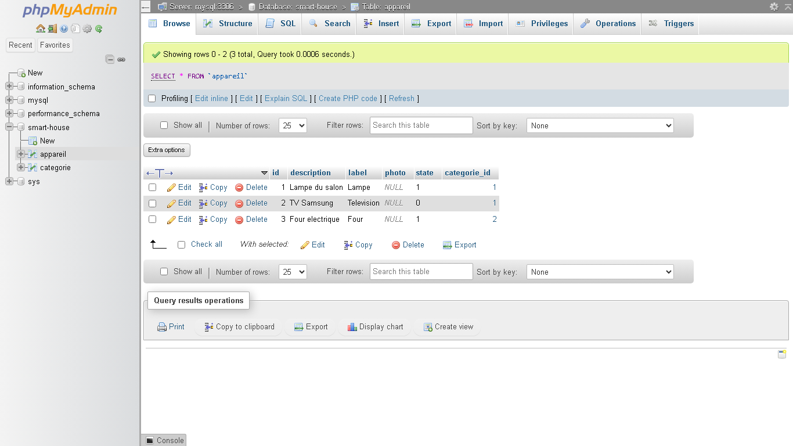

# TP 24 : Conteneurisation Spring Angular

Application Smart Home conteneurisée avec Docker : backend Spring Boot + MySQL, frontend Angular servi par Nginx, et phpMyAdmin, orchestrés avec `docker-compose`.

```bash
cd smarthouse
docker-compose build
docker-compose up -d
docker-compose ps
```

## 1. État des conteneurs



Les quatre conteneurs (mysql, backend, frontend, phpmyadmin) sont en cours d'exécution avec leurs ports exposés (3306, 8085, 80, 8081).

## 2. Application frontend sur http://localhost



L'application Angular servie par Nginx affiche les appareils récupérés depuis le backend Spring Boot.

## 3. phpMyAdmin sur http://localhost:8081



phpMyAdmin montre la base `smart-house` avec les tables `appareil` et `categorie` créées par le backend et remplies avec les données de l'application.
